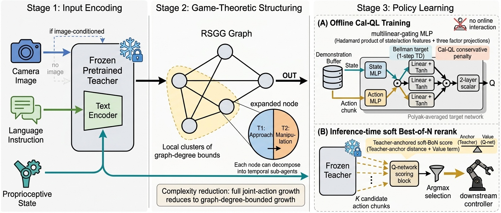
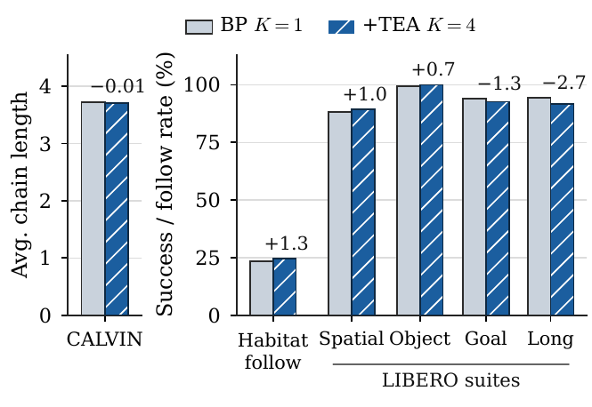
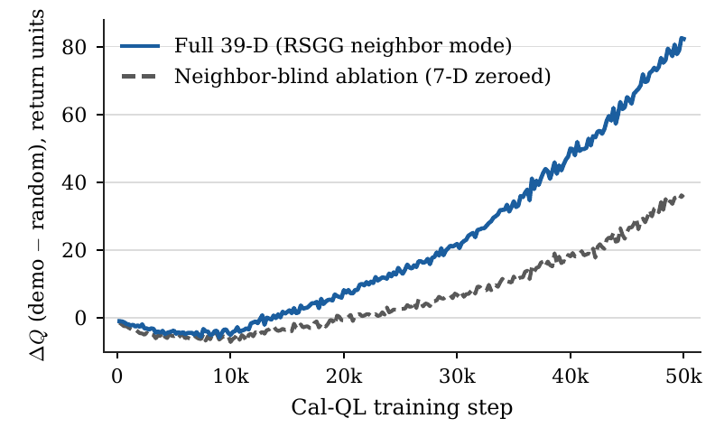
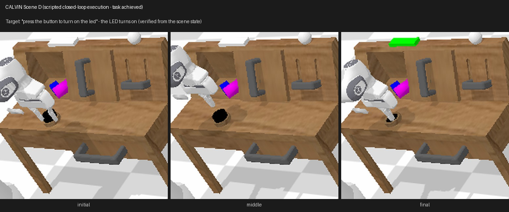
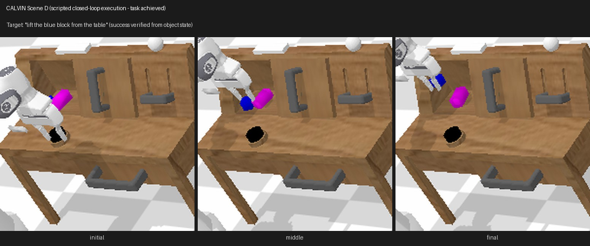
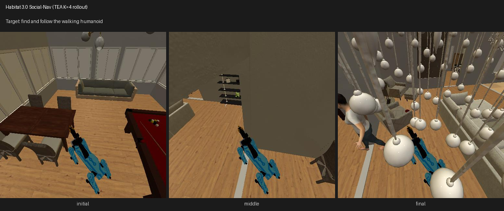
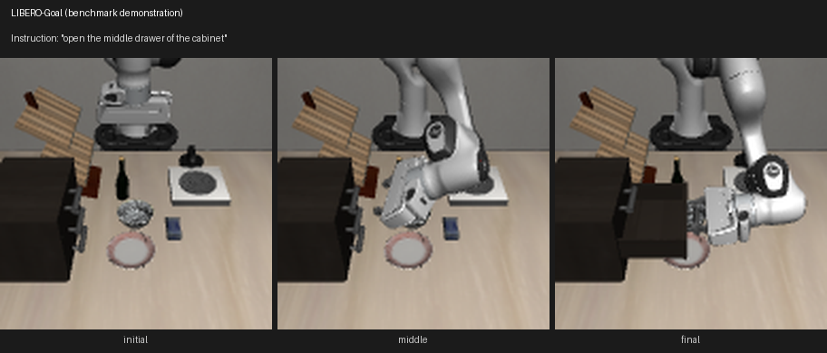
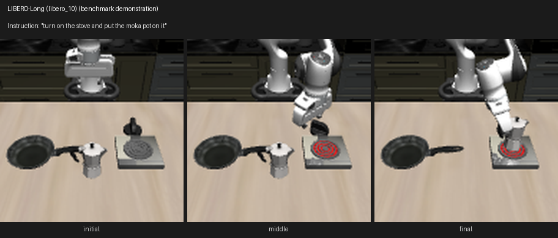

# TEA: Trustworthy Embodied Agents via Value-Guided Reranking of Behavior Priors

[](LICENSE)
[](requirements.txt)
[](requirements.txt)
[](https://github.com/1ncompleteness/TEA/releases/tag/v1.0.0)

**Behrouz Barati B\*** and **Qiuyuan Huang**  
*Department of Computer Science, California State University, Northridge, Northridge, CA, USA*  
*\*Equal contribution*

Official code, trained critics, and raw evaluation logs for the manuscript **TEA: Trustworthy Embodied Agents via Value-Guided Reranking of Behavior Priors** (submitted to the Work-in-Progress track of RiTA 2026; not peer-reviewed yet).

<p align="center">
  
</p>

---

## Overview

Embodied robotic agents deployed in unstructured physical environments face simultaneous challenges in high-dimensional action-chunk evaluation, multi-agent social coordination, and calibrated out-of-distribution (OOD) safety. **TEA** introduces a modular three-layer framework that upgrades frozen pretrained embodied behavior priors (**MDT-V**, **FLOWER VLA**, and **Habitat 3.0 DD-PPO**) at deployment time **without fine-tuning a single parameter of the underlying policy**:

1. **Adaptive State Function (ASF):** Low-rank multilinear critic (`ActionChunkQNetwork` / `QEnsemble`) that evaluates high-dimensional state and multi-step action chunks via element-wise Hadamard mode fusion in $O(R(d_s + C d_a) + M R^2)$ parameters and operations instead of exponential tensor grids.
2. **Robust Stochastic Game Graph (RSGG):** Neighbor-conditioned state factorization along sparse spatial interaction graphs $\mathcal{G} = (\mathcal{N}, \mathcal{E})$, enabling coordinated social navigation without joint action-space blowup.
3. **Trustworthy Policy Extraction (TPE):** Offline **Calibrated Q-Learning (Cal-QL)** critics paired with test-time reranking of $K=4$ prior samples (**Soft Best-of-$N$** with $\alpha=2.0$, $\sigma=0.2$ on Habitat and LIBERO; hard $Q$-argmax on CALVIN) and trust diagnostics (**ECE**, **Cal-QL Coverage**, **OOD Margin $\Delta Q$**, **Bellman Residual $\delta$**, and **$\varepsilon_{\text{QRE}}$**).

---

## Benchmark Results & Visual Showcase

<p align="center">
  
  
</p>

> **Full Rollout Videos (`v1.0.0` Release):** All **33 captioned `.mp4` evaluation rollout videos** across CALVIN Scene D, Habitat 3.0 Social-Nav, and LIBERO Manipulation are hosted in [**GitHub Release `v1.0.0`**](https://github.com/1ncompleteness/TEA/releases/tag/v1.0.0).

All numbers below match the manuscript tables and the raw logs in [`evaluation_results/`](evaluation_results). Differences between the frozen prior ($K=1$) and +TEA ($K=4$) are small; none is claimed as statistically significant.

### 1. CALVIN Long-Horizon Language-Conditioned Manipulation (`D -> D`)

<p align="center">
  
  
</p>

Published baselines use 1,000 LH-MTLC chains. Our same-checkpoint `mdtv-1-d` rerun ($K=1$) and +TEA use **100 chains** each (`num_sequences=100`), so they are not directly comparable to the published rows. On CALVIN, +TEA picks the candidate with the highest $Q$ (hard argmax over $K=4$). Per-position rates of the $K=1$ rerun were not logged.

| Method | 1/5 (%) | 2/5 (%) | 3/5 (%) | 4/5 (%) | 5/5 (%) | Avg. Chain Length |
| :--- | :---: | :---: | :---: | :---: | :---: | :---: |
| GCBC *(published)* | 64.7 | 28.4 | 12.2 | 4.9 | 1.3 | 1.11 |
| MCIL *(published)* | 76.4 | 48.8 | 30.1 | 18.1 | 9.3 | 1.82 |
| HULC *(published)* | 82.5 | 66.8 | 52.0 | 39.3 | 27.5 | 2.68 |
| LCD *(published)* | 88.7 | 69.9 | 54.5 | 42.7 | 32.2 | 2.88 |
| MT-ACT *(published)* | 88.4 | 72.2 | 57.2 | 44.9 | 35.3 | 2.98 |
| MDT *(published)* | 93.3 | 82.4 | 71.5 | 60.9 | 51.1 | 3.59 |
| MDT-V *(published)* | 93.7 | 84.5 | 74.1 | 64.4 | 55.6 | 3.72 |
| MDT-V $K=1$ *(our rerun, 100 chains)* | – | – | – | – | – | 3.52 |
| MDT-V + TEA $K=4$ *(ours, 100 chains)* | 95.0 | 84.0 | 73.0 | 64.0 | 55.0 | 3.71 |

### 2. Habitat 3.0 Multi-Agent Social Navigation

<p align="center">
  
</p>

Paired evaluation of `social_nav_latest.pth` (mean ± SE). $K=1$ and +TEA: 5 seeds × 30 episodes ($n=150$). Neighbor-blind ablation: 2 seeds × 30 episodes ($n=60$). The $K=1$ vs. +TEA differences lie within one standard error.

| Arm | Finding success $S$ $\uparrow$ | Following rate $F$ $\uparrow$ | Collision rate $\downarrow$ | Steps-to-encounter $\downarrow$ |
| :--- | :---: | :---: | :---: | :---: |
| DD-PPO $K=1$ (frozen prior) | 0.68 ± 0.04 | 0.23 ± 0.02 | 0.55 ± 0.04 | 557 |
| DD-PPO + TEA $K=4$ | 0.69 ± 0.04 | 0.25 ± 0.02 | 0.52 ± 0.04 | 502 |
| + TEA $K=4$, neighbor-blind (RSGG features zeroed) | 0.67 ± 0.06 | 0.18 ± 0.03 | 0.50 ± 0.06 | 603 |

### 3. LIBERO Robotic Manipulation Suites (FLOWER Prior)

<p align="center">
  
  
</p>

Paired `flower_libero` reruns: Spatial and Object use 6 seeds × 10 tasks × 10 episodes ($n=600$); Goal and Long use 3 seeds ($n=300$). No single-suite difference is significant under a paired exact test (Object: exact two-sided McNemar $p=0.125$).

| Suite | FLOWER $K=1$ (%) | + TEA $K=4$ (%) | $\Delta$ (pp) |
| :--- | :---: | :---: | :---: |
| LIBERO-Spatial | 88.3 (530/600) | 89.3 (536/600) | +1.0 |
| LIBERO-Object | 99.3 (596/600) | 100.0 (600/600) | +0.7 |
| LIBERO-Goal | 94.0 | 92.7 | −1.3 |
| LIBERO-Long (`libero_10`) | 94.3 | 91.7 | −2.7 |

### 4. Trust Diagnostics

Computed by [`compute_trust_calibration.py`](code/trustworthy_calibration/compute_trust_calibration.py) on a random 10% subset of each critic's **training** buffer ($N$ below). These rows are in-sample diagnostics, not held-out estimates. $\hat\varepsilon = 2\hat\delta + \tau \log K$ with $\tau=2.0$, $K=4$ is an empirical proxy over the $K$ sampled candidates, not a certificate. Habitat uses dense rewards, so its magnitudes are not comparable to the manipulation rows.

| Benchmark / Suite | $N$ | ECE | Cov | $\Delta Q$ | $\hat\delta$ (95th pct.) | $\hat\varepsilon$ |
| :--- | :---: | :---: | :---: | :---: | :---: | :---: |
| CALVIN (`D -> D`) | 20,000 | 1.06 | 1.00 | 1.64 | 0.36 | 3.49 |
| Habitat 3.0 Social-Nav | 23,713 | 114.20 | 1.00 | 60.74 | 5.05 | 12.87 |
| LIBERO-Spatial | 6,225 | 0.52 | 1.00 | 0.83 | 0.07 | 2.92 |
| LIBERO-Object | 7,450 | 0.50 | 1.00 | 0.94 | 0.04 | 2.84 |
| LIBERO-Goal | 6,372 | 0.51 | 1.00 | 1.08 | 0.07 | 2.92 |
| LIBERO-Long (`libero_10`) | 13,809 | 0.35 | 1.00 | 1.02 | 0.10 | 2.97 |

---

## Repository Structure

```text
TEA/
├── assets/                       # Pipeline architecture, plots, and composite rollout banners
├── code/
│   ├── calvin/                   # CALVIN D->D cache builder, ActionChunkQNetwork training & eval scripts
│   │   ├── training/             # train_tea_mdt.py, cache_calvin_data_chunked.py
│   │   └── testing/              # run_mdt_eval.sh, run_mdt_tea_eval.sh, aggregate_calvin_34task.py
│   ├── habitat/                  # Habitat 3.0 Social-Nav 39-D RSGG featurization, Cal-QL QEnsemble & eval
│   │   ├── training/             # train_tea_habitat.py, pa_rl.py (full & --neighbor_blind RSGG ablation)
│   │   ├── testing/              # tea_habitat_eval.py, habitat_trust_calib.py, merge_evals.py, smoke.py
│   │   └── run_habitat_pipeline.sh
│   ├── libero/                   # LIBERO per-suite Cal-QL critic training & FLOWER VLA Soft-BoN reranking
│   │   ├── training/             # train_tea_libero.py, train_q_chunked.py, cache_libero_data_chunked.py
│   │   └── testing/              # run_libero_flower_tea.py, run_flower_libero_pertask.sh
│   └── trustworthy_calibration/  # Shared ECE, Cal-QL coverage, ΔQ margin, δ, and ε diagnostic suite
│       └── compute_trust_calibration.py
├── dataset/                      # 5,000-transition smoke-test subsets for instant out-of-the-box testing
│   ├── calvin/                   # calvin_dd_chunk10_subset.npz
│   ├── habitat/                  # habitat_socialnav_chunk1_subset.npz
│   └── libero/                   # libero_spatial_chunk8_subset.npz
├── evaluation_results/           # Complete raw per-seed JSON evaluation logs & trust calibration records
│   ├── calvin/
│   ├── habitat/
│   └── libero/
└── trained_checkpoints/          # Pretrained multilinear Cal-QL Q-network & Q-ensemble weights (.pt)
    ├── calvin/                   # calvin_q_network_seed42/q_network.pt
    ├── habitat/                  # habitat_q_ensemble_full.pt, habitat_q_ensemble_neighbor_blind.pt
    └── libero/                   # libero_{spatial,object,goal,long}_q_network_seed42/q_network.pt
```

---

## Quickstart: Out-of-the-Box Smoke Test (CPU or GPU, No Simulators Required)

All pretrained multilinear Cal-QL critics (`trained_checkpoints/`) and 5,000-transition subset buffers (`dataset/`) are included directly in this repository so you can verify model loading, multilinear mode fusion, and trustworthiness calibration in **under 3 seconds on CPU**:

```bash
git clone https://github.com/1ncompleteness/TEA.git
cd TEA
pip install -r requirements.txt

# 1. LIBERO-Spatial multilinear Q-network smoke test
python code/trustworthy_calibration/compute_trust_calibration.py \
  --ckpt trained_checkpoints/libero/libero_spatial_q_network_seed42/q_network.pt \
  --chunk_npz dataset/libero/libero_spatial_chunk8_subset.npz \
  --state_dim 15 --action_dim 7 --chunk_size 1 --num_actions 4 \
  --hidden_dim 512 --label "LIBERO Spatial (smoke subset)"

# 2. CALVIN D->D chunk-10 multilinear Q-network smoke test
python code/trustworthy_calibration/compute_trust_calibration.py \
  --ckpt trained_checkpoints/calvin/calvin_q_network_seed42/q_network.pt \
  --chunk_npz dataset/calvin/calvin_dd_chunk10_subset.npz \
  --state_dim 39 --action_dim 7 --chunk_size 10 --num_actions 4 \
  --hidden_dim 512 --label "CALVIN D->D (smoke subset)"

# 3. Habitat 3.0 Social-Nav 4-member multilinear Q-ensemble smoke test
python code/trustworthy_calibration/compute_trust_calibration.py \
  --ckpt trained_checkpoints/habitat/habitat_q_ensemble_full.pt \
  --chunk_npz dataset/habitat/habitat_socialnav_chunk1_subset.npz \
  --state_dim 39 --action_dim 2 --chunk_size 1 --num_actions 4 \
  --use_ensemble --n_ensemble 4 --hidden_dim 256 \
  --label "Habitat 3.0 Social-Nav (smoke subset)"
```

> **Note:** Shipped checkpoints in `trained_checkpoints/` were trained on the **complete** benchmark buffers (CALVIN: 512,077 transitions; Habitat: 237,131 transitions across 500 DD-PPO episodes; LIBERO: all 50 demos $\times$ 10 tasks per suite), not on the 5,000-row smoke-test subsets in `dataset/`. Pass the full regenerated `chunk*.npz` caches (below) to reproduce every paper diagnostic row identically.

---

## Full Benchmark Reproduction

### Public Datasets & Frozen Behavior-Prior Checkpoints

1. **CALVIN (`task_D_D` + MDT-V `mdtv-1-d`):**
   - Dataset: [`http://calvin.cs.uni-freiburg.de/dataset/task_D_D.zip`](http://calvin.cs.uni-freiburg.de/dataset/task_D_D.zip) via [`mees/calvin`](https://github.com/mees/calvin).
   - Frozen prior: [`intuitive-robots/mdt_policy`](https://github.com/intuitive-robots/mdt_policy) (`mdtv-1-d` checkpoint).
2. **Habitat 3.0 Social-Nav (`hab3-episodes` + DD-PPO Spot):**
   - Environment: Python 3.9, `habitat-sim==0.3.3` (`headless`, `withbullet`, conda channel `aihabitat`), `habitat-lab==0.3.3`.
   - Assets:
     ```bash
     python -m habitat_sim.utils.datasets_download \
       --uids hssd-hab hab3-episodes habitat_humanoids hab3_bench_assets hab_spot_arm ycb
     ```
   - Frozen prior: `social_nav_latest.pth` from [`ai-habitat/hab3_episodes`](https://huggingface.co/datasets/ai-habitat/hab3_episodes/tree/main/checkpoint), placed at `code/habitat/ckpt/social_nav_latest.pth`.
3. **LIBERO (`libero_{spatial,object,goal,10}` + FLOWER VLA):**
   - Environment: Python 3.10, `mujoco==2.3.7`, `robosuite==1.4.0`, `transformers==4.40.1`, `MUJOCO_GL=egl`, editable installs of [`Lifelong-Robot-Learning/LIBERO`](https://github.com/Lifelong-Robot-Learning/LIBERO) and [`intuitive-robots/flower_vla_calvin`](https://github.com/intuitive-robots/flower_vla_calvin).
   - Datasets: [`yifengzhu-hf/LIBERO-datasets`](https://huggingface.co/datasets/yifengzhu-hf/LIBERO-datasets).
   - Frozen priors: `mbreuss/flower_libero_{spatial,object,goal,10}` on Hugging Face.

### Running Full Training & Evaluation Pipelines

- **Habitat 3.0 Social-Nav (end-to-end demo collection, full + neighbor-blind Cal-QL training, 5-seed paired evaluation, and trust calibration):**
  ```bash
  bash code/habitat/run_habitat_pipeline.sh
  ```
- **LIBERO Manipulation (per-task isolated GL-process evaluation with FLOWER VLA + Soft Best-of-$N$):**
  ```bash
  export PYTHONPATH="<path_to_LIBERO>:<path_to_flower_vla_calvin>"
  export MUJOCO_GL=egl
  bash code/libero/testing/run_flower_libero_pertask.sh \
    libero_spatial 42 soft \
    trained_checkpoints/libero/libero_spatial_q_network_seed42/q_network.pt
  ```
- **CALVIN `D -> D` Q-Network Training & Chain Aggregation:**
  - Build feature cache via `code/calvin/training/cache_calvin_data_chunked.py` and train via `code/calvin/training/train_tea_mdt.py`.
  - *Transparency disclosure:* `code/calvin/testing/run_mdt_eval.sh` ($K=1$) and `run_mdt_tea_eval.sh` (+TEA) both run 100 chains. The +TEA script passes `TEA_Q_PATH`/`TEA_K` to an evaluation-loop hook inside a local MDT checkout that is **not** redistributed here, so the CALVIN +TEA arm cannot yet be rerun from this repository alone. `evaluation_results/calvin/calvin_chain_eval_aggregate.json` stores only the summary (avg. chain length 3.52 for $K=1$ and 3.71 for +TEA, 100 chains each), not per-chain records.

---

## Citation

If you find TEA useful in your research, please cite:

```bibtex
@misc{baratib2026tea,
  author = {Barati B, Behrouz and Huang, Qiuyuan},
  title  = {{TEA}: Trustworthy Embodied Agents via Value-Guided Reranking of Behavior Priors},
  year   = {2026},
  note   = {Manuscript submitted to the Work-in-Progress track of RiTA 2026},
  url    = {https://github.com/1ncompleteness/TEA}
}
```

## License

This project is released under the [MIT License](LICENSE).
