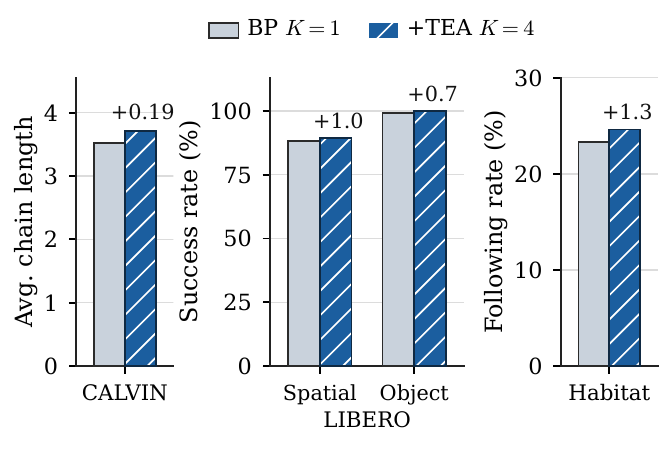
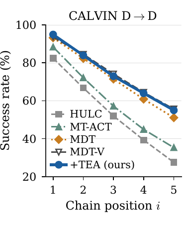
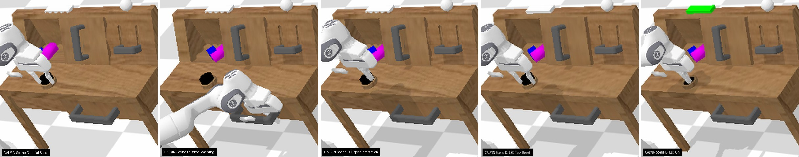
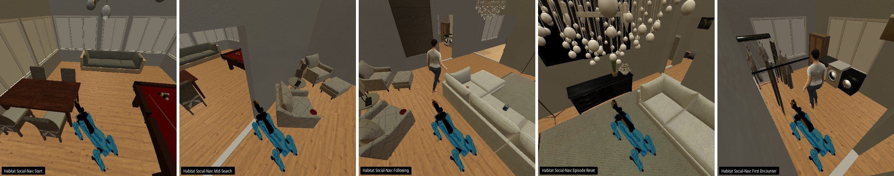
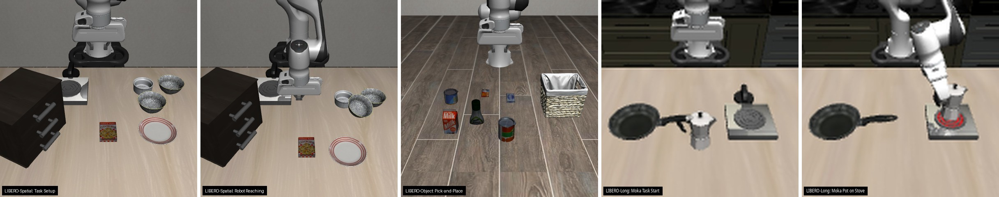
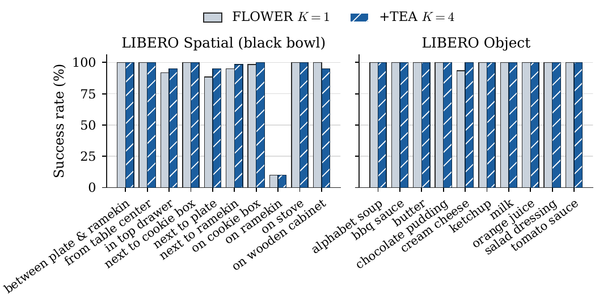

# TEA: Trustworthy Embodied Agents via Value-Guided Reranking of Behavior Priors

[](LICENSE)
[](requirements.txt)
[](requirements.txt)
[](https://github.com/1ncompleteness/TEA/releases/tag/v1.0.0)

**Behrouz Barati B** and **Enno Qiuyuan Huang\***  
*Department of Computer Science, California State University, Northridge, Northridge, CA, USA*  
*\*Corresponding author*

Official code, trained critics, and raw evaluation logs for the manuscript **TEA: Trustworthy Embodied Agents via Value-Guided Reranking of Behavior Priors** (accepted as a Work-in-Progress paper at RiTA 2026, the 14th International Conference on Robot Intelligence Technology and Applications, Daejeon, Korea, December 2-4, 2026).

<p align="center">
  
</p>

---

## Overview

Generative imitation policies, or Behavior Priors (BPs), produce realistic action chunks but offer no value estimate to choose among them. **TEA** keeps a pretrained BP frozen (**MDT-V** on CALVIN, **FLOWER** on LIBERO, the **DD-PPO** Spot policy on Habitat 3.0 Social-Nav) and adds a compact critic, trained offline, that reranks a few BP samples at deployment. No parameter of the prior is fine-tuned, and every executed action is a BP sample. We call this *trustworthy* in a narrow, checkable sense: every executed action is a sample of the frozen prior (by construction), and the offline critic ranks demonstrated actions above random ones (audited with the in-sample diagnostics below). It is not a safety guarantee. The three stages below follow the pipeline figure and Section 3 of the paper.

1. **Stage 1: Input encoding.** Camera images and language instructions feed only the frozen BP, which also receives proprioception if it is conditioned on it (dashed arrow) and is reused unchanged in Stage 3(B); TEA never reads pixels or text. MDT-V encodes the instruction with a frozen CLIP text encoder and its two camera views with Voltron, FLOWER encodes both camera views and the instruction jointly with a Florence-2 encoder, and the DD-PPO Social-Nav policy uses depth and receives no language. The critic sees a compact state vector $s$, which feeds the RSGG and the Q-network scoring block:
   - **CALVIN** ($d_s=39$): 15-D robot proprioception (end-effector position and orientation, gripper width, joint angles, gripper action) plus the 24-D scene state (door, drawer, button, switch, and light states, and the poses of three blocks). The scene state is privileged simulator state that the prior never sees.
   - **LIBERO** ($d_s=15$): end-effector position (3-D) and orientation (3-D), gripper state (2-D), and joint angles (7-D).
   - **Habitat 3.0 Social-Nav** ($d_s=39$): a 7-D neighbor block (the humanoid's 3-D world-frame position, privileged simulator state, and four statistics of the humanoid-detector bounding-box mask in the arm camera: mean, maximum, and normalized center), followed by $4\times4$ average-pooled grids of the arm depth image (16-D) and the head stereo depth image (16-D). This vector contains no robot proprioception.
2. **Stage 2: Game-theoretic structuring (Robust Stochastic Game Graph, RSGG).** Agents are linked when one agent's action affects another's transition or reward. Each agent's value is modelled as depending on the others only through its neighbors, so with maximum degree $d$ local evaluation scales as $O(n|\mathcal{A}|^{d+1})$ instead of $O(|\mathcal{A}|^n)$, still exponential in $d$ but linear in $n$. In Habitat ($n=2$, $d=1$) the humanoid is the robot's only neighbor and its 7-D features enter the robot critic's state (the neighbor enters through its state, not its actions), so the degree bound is not exercised and no equilibrium is computed. Temporal sub-agents (approach, then manipulation) are a conceptual view only; one shared critic is trained.
3. **Stage 3: Policy learning (Trustworthy Policy Extraction, TPE).** (A) Offline Cal-QL training of a multilinear critic, with no online interaction; (B) inference-time Soft Best-of-$N$ reranking, in which the trained critic scores $K=4$ candidates from the same frozen BP. Details below.

### Critic and training objective (Stage 3A)

The critic is a multilinear-gating MLP ([`ActionChunkQNetwork`](code/calvin/training/train_tea_mdt.py) for CALVIN and LIBERO, [`PARLQNetwork`/`QEnsemble`](code/habitat/training/pa_rl.py) for Habitat):

```math
Q_i(s,a) = g\Big(\prod_{m=1}^{M} \psi_m\big(\phi_s(s) \odot \phi_a(a)\big)\Big),
```

with a state MLP $\phi_s$ ($d_s \to R \to R$, ReLU and LayerNorm) and an action MLP $\phi_a$ ($C d_a \to 256 \to R$, ReLU and LayerNorm) of the state and the flattened $C$-step action chunk, $M=3$ linear-tanh factor projections $\psi_m: \mathbb{R}^R \to \mathbb{R}^R$, and a two-layer MLP head $g$ ($R \to 128 \to 1$), i.e. $O(R(d_s + C d_a) + M R^2)$ parameters.

Each transition $(s, a, r, s', a', d)$ in the demonstration buffer pairs a state and a demonstrated chunk with the reward, the next state $s'$ after the chunk, the next demonstrated chunk $a'$, and a termination flag $d$. The manipulation buffers are reward-free, so each successful demonstration of length $T$ (on CALVIN, each language-annotated segment, from inside which all transitions are sampled) becomes an episode with a sparse success reward at its last step. On Habitat, the buffer holds 500 stochastic rollouts of the frozen DD-PPO prior with the environment's native dense reward, and the target network is evaluated at $s'$ with the logged action $a$ in place of $a'$. Each reward comes with a Cal-QL reference value $V_{\text{ref}}$, the demonstration's Monte Carlo return-to-go (set to 0 on Habitat):

```math
(r_t, V_{\text{ref}}) = \big(\mathbb{I}[t=T],\ \gamma^{T-t}\big) \text{ on manipulation and } \big(r_t^{\text{SN}},\ 0\big) \text{ on Habitat},
```

a sparse success reward ending each length-$T$ demonstration segment (with $d=1$ there) or Habitat 3.0's native dense Social-Nav reward. With the one-step Bellman target $y = r + \gamma(1-d) Q_i^{\text{tgt}}(s', a')$ from a Polyak-averaged target network and a random chunk $a_{\text{rnd}} \sim \mathcal{U}(-1,1)^{C d_a}$, each critic minimizes

```math
\mathcal{L}_{\text{TD}} = \big(Q_i(s,a) - y\big)^2, \qquad \mathcal{L}_{\text{CQL}} = \big[Q_i(s,a_{\text{rnd}}) - \max\big(\text{sg}[Q_i(s,a)],\ V_{\text{ref}}\big)\big]_+, \qquad \mathcal{L}(Q_i) = \mathbb{E}\big[\mathcal{L}_{\text{TD}} + \lambda\,\mathcal{L}_{\text{CQL}}\big].
```

The penalty is active only when a random chunk would outscore both the demonstrated chunk and the reference value. On CALVIN, $r$ sums the rewards of the 10-step chunk and $y$ discounts once per chunk, whereas $V_{\text{ref}}$ discounts per frame. Manipulation critics use one random chunk per state. On Habitat ([`calql_loss`](code/habitat/training/pa_rl.py)), the TD term averages a four-member ensemble against an ensemble-minimum target, and the penalty uses the ensemble-mean $Q$ at the best of 10 random actions.

### Reranking (Stage 3B)

At each replanning step the frozen BP draws $K=4$ candidate chunks $a^{(1)},\dots,a^{(K)}$ and a reference anchor $a^{(0)}$; the frozen critic scores them and TEA executes $a^{(k^\star)}$ with

```math
k^\star = \arg\max_k \Big\{-\tfrac{1}{2\sigma^2}\big\|a^{(k)} - a^{(0)}\big\|_2^2 + \tfrac{1}{\alpha}\,Q_i\big(s, a^{(k)}\big)\Big\},
```

a deterministic, teacher-anchored variant of Soft Best-of-$N$ with $\alpha=2$ and $\sigma=0.2$ on Habitat and LIBERO, and the hard $Q$-argmax ($\sigma\to\infty$) on CALVIN. The Gaussian proximity term is a heuristic distance, not the prior's log-density, and the rule is not an exact Soft Best-of-$N$ or quantal-response policy. Candidates and anchors per prior:

- **CALVIN (MDT-V):** $K=4$ sampled 10-step chunks, scored in full ($C=10$) and selected by hard argmax; the chosen chunk runs open loop until the next replan.
- **LIBERO (FLOWER):** $K=4$ stochastic 10-step flow chunks plus a chunk drawn with seeded noise (a fixed function of seed, episode, and step) that serves as the anchor and is itself a candidate ($k \ge 0$); $Q_i$ and the distance use the first action of each chunk ($C=1$), and the selected chunk executes open loop for its 10 steps.
- **Habitat (DD-PPO):** $K=4$ stochastic 2-D base-velocity actions from the Gaussian policy head, with its deterministic action as the anchor, which is not a candidate ($k \ge 1$); reranking runs at every control step ($C=1$).

Scoring adds $O(KMR^2)$ critic computation per replanning step, on top of $K$ calls to the prior. TEA never executes an action the prior did not propose; prior samples themselves carry no guarantee of lying in the demonstration support or of being safe.

### Hyperparameters

| | CALVIN | LIBERO (per suite) | Habitat 3.0 |
| :--- | :---: | :---: | :---: |
| Frozen BP | MDT-V (`mdtv-1-d`) | FLOWER (`flower_libero`) | DD-PPO (`social_nav_latest.pth`) |
| State dim. $d_s$ | 39 | 15 | 39 |
| Action dim. $d_a$, chunk $C$ | 7, 10 | 7, 1 | 2, 1 |
| Rank $R$, projections $M$ | 512, 3 | 512, 3 | 256, 3 (4-member ensemble) |
| Critic parameters | 1.29M | 1.26M | 4 × 0.37M |
| Cal-QL weight $\lambda$ | 0.5 | 0.5 | 0.01 |
| Adam steps / batch | 50,000 / 64 | 50,000 / 64 | 50,000 / 256 |

All critics: learning rate $3\times10^{-4}$, $\gamma=0.99$, Polyak rate 0.005, gradient-norm clip 1.0. All runs use one NVIDIA RTX 4090 GPU.

---

## Benchmark Results & Visual Showcase

<p align="center">
  
  
</p>

*Left: same-checkpoint BP $K=1$ vs. +TEA $K=4$ with deltas on CALVIN (average chain length, 100 chains), LIBERO (success, %), and Habitat (following rate $F$, %). Right: CALVIN success per chain position (+TEA: 100 chains; baselines: 1000).*

> **Videos (`v1.0.0` Release):** 33 captioned `.mp4` videos are attached to [**GitHub Release `v1.0.0`**](https://github.com/1ncompleteness/TEA/releases/tag/v1.0.0): 4 Habitat 3.0 Social-Nav rollouts (one two-part video with a DD-PPO $K=1$ episode and a TEA $K=4$ episode, and three further TEA $K=4$ episodes), 9 CALVIN Scene D task visualizations driven by a scripted closed-loop controller (not a learned policy; completion verified from the scene state), and 20 LIBERO benchmark demonstrations (10 LIBERO-Goal and 10 LIBERO-Long tasks). Each video's burned-in caption states what it shows.

Every benchmark compares the frozen BP ($K=1$) with the same checkpoint plus TEA ($K=4$) on identical evaluation streams; this paired comparison isolates the reranking layer. Published baselines differ per benchmark and serve as context only. All numbers below match the raw logs in [`evaluation_results/`](evaluation_results) and the RiTA 2026 paper (the published MDT-V row and the $K=1$ rerun appear in the paper's text rather than in its CALVIN table). Differences between the frozen prior ($K=1$) and +TEA ($K=4$) are small; none is claimed as statistically significant.

### 1. CALVIN Long-Horizon Language-Conditioned Manipulation (`D -> D`)

<p align="center">
  
</p>

*CALVIN Scene D: initial, reaching, interaction; "press the button to turn on the led" (reset, verified LED on).*

The frozen prior is the public MDT-V checkpoint `mdtv-1-d`, which predicts 10-action chunks with 10 DDIM denoising steps and executes each chunk open loop. Published baselines use 1,000 LH-MTLC chains. Our same-checkpoint `mdtv-1-d` rerun ($K=1$) and +TEA use **100 chains** each (`num_sequences=100`), so they are not directly comparable to the published rows, and the published MDT-V result (3.72) is not reproduced by our same-checkpoint rerun (3.52). On CALVIN, +TEA picks the candidate with the highest $Q$ (hard argmax over $K=4$). Per-position rates of the $K=1$ rerun were not logged.

| Method | 1/5 (%) | 2/5 (%) | 3/5 (%) | 4/5 (%) | 5/5 (%) | Avg. Chain Length |
| :--- | :---: | :---: | :---: | :---: | :---: | :---: |
| GCBC *(published)* | 64.7 | 28.4 | 12.2 | 4.9 | 1.3 | 1.11 |
| MCIL *(published)* | 76.4 | 48.8 | 30.1 | 18.1 | 9.3 | 1.82 |
| HULC *(published)* | 82.5 | 66.8 | 52.0 | 39.3 | 27.5 | 2.68 |
| LCD *(published)* | 88.7 | 69.9 | 54.5 | 42.7 | 32.2 | 2.88 |
| MT-ACT *(published)* | 88.4 | 72.2 | 57.2 | 44.9 | 35.3 | 2.98 |
| MDT *(published)* | 93.3 | 82.4 | 71.5 | 60.9 | 51.1 | 3.59 |
| MDT-V *(published)* | 93.7 | 84.5 | 74.1 | 64.4 | 55.6 | 3.72 |
| MDT-V $K=1$ *(our rerun, 100 chains)* | – | – | – | – | – | 3.52 |
| MDT-V + TEA $K=4$ *(ours, 100 chains)* | 95.0 | 84.0 | 73.0 | 64.0 | 55.0 | 3.71 |

### 2. Habitat 3.0 Multi-Agent Social Navigation

<p align="center">
  
</p>

*Habitat 3.0 Social-Nav: start, mid-search, following; a found episode (reset, first encounter).*

A Spot robot must find and then follow a scripted humanoid that walks to random waypoints in HSSD scenes, over episodes of up to $H=1500$ steps. We run `habitat-lab` and `habitat-sim` v0.3.3; under this build the validation split fails to load, so all arms share identical paired training-split episode streams. Paired evaluation of `social_nav_latest.pth` (mean ± SE): $K=1$ and +TEA use 5 seeds × 30 episodes ($n=150$); the neighbor-blind ablation uses 2 seeds × 30 episodes ($n=60$). Following rate $F$ is the fraction of post-encounter steps on which the humanoid is found; steps-to-encounter is averaged over episodes that find the humanoid. The $K=1$ vs. +TEA differences lie within one standard error.

| Arm | Finding success $S$ $\uparrow$ | Following rate $F$ $\uparrow$ | Collision rate $\downarrow$ | Steps-to-encounter $\downarrow$ |
| :--- | :---: | :---: | :---: | :---: |
| DD-PPO $K=1$ (frozen prior) | 0.68 ± 0.04 | 0.23 ± 0.02 | 0.55 ± 0.04 | 557 |
| DD-PPO + TEA $K=4$ | 0.69 ± 0.04 | 0.25 ± 0.02 | 0.52 ± 0.04 | 502 |
| + TEA $K=4$, neighbor-blind (RSGG features zeroed) | 0.67 ± 0.06 | 0.18 ± 0.03 | 0.50 ± 0.06 | 603 |

Zeroing the RSGG neighbor block at training and inference lowers the following rate from 0.26 to 0.18 and slows the encounter from 540 to 603 steps relative to TEA on the same two seeds ($n=60$); this drop is directional but not significant on matched seeds. During offline training, the full 39-D critic also separates demonstrated from random actions more strongly than the neighbor-blind critic: at the 50k-step budget its training-batch demo-versus-random margin is 82.3 against 35.6 return units, a 2.3-fold difference.

<p align="center">
  
</p>

### 3. LIBERO Robotic Manipulation Suites (FLOWER Prior)

<p align="center">
  
</p>

*LIBERO: Spatial setup and reaching, Object scene; LIBERO-Long "turn on the stove and put the moka pot on it" (initial, completion).*

Each suite uses its public `flower_libero` flow-matching checkpoint and its own critic, trained on the suite's 500 demonstrations; each task runs in an isolated subprocess to avoid MuJoCo OpenGL context leaks. Paired reruns: Spatial and Object use 6 seeds × 10 tasks × 10 episodes ($n=600$); Long uses 3 seeds ($n=300$). Baseline rows are as reported by OpenVLA (Kim et al., 2024). No single-suite difference is significant under a paired exact test (Object: exact two-sided McNemar $p=0.125$).

| Method | LIBERO-Spatial (%) | LIBERO-Object (%) | LIBERO-Long (`libero_10`) (%) |
| :--- | :---: | :---: | :---: |
| OpenVLA *(published)* | 84.7 | 88.4 | 53.7 |
| Octo, fine-tuned *(published)* | 78.9 | 85.7 | 51.1 |
| Diffusion Policy *(published)* | 78.3 | 92.5 | 50.5 |
| FLOWER $K=1$ *(our rerun)* | 88.3 (530/600) | 99.3 (596/600) | 94.3 |
| FLOWER + TEA $K=4$ *(ours)* | 89.3 (536/600) | 100.0 (600/600) | 91.7 |
| $\Delta$ (pp) | +1.0 | +0.7 | −2.7 |

Per task ($6\ \text{seeds} \times 10\ \text{episodes} = 60$ rollouts per task and arm): on Object, TEA reaches 60/60 on every task, converting all four baseline failures on the *cream cheese* task (56/60 to 60/60). On Spatial, TEA improves four tasks (*in top drawer*, *next to plate*, *next to ramekin*, *on cookie box*), ties on five (including the bottleneck task *on ramekin* at 10.0%), and dips on one (*on wooden cabinet*).

<p align="center">
  
</p>

### 4. Trust Diagnostics

Computed by [`compute_trust_calibration.py`](code/trustworthy_calibration/compute_trust_calibration.py) on a random 10% subset of each critic's **training** buffer ($N$ states below; for CALVIN, from a 200k-frame subsample). These rows are in-sample diagnostics, not held-out estimates. The demo-vs-random margin is $\Delta Q = \mathbb{E}[Q_i(s,a) - \bar{Q}^{\text{rnd}}_i(s)]$, where $\bar{Q}^{\text{rnd}}_i$ averages five uniform-random chunks, and the coverage is Cov $= \Pr[\bar{Q}^{\text{rnd}}_i(s) \le \max(Q_i(s,a), \tilde{V})]$ with $\tilde{V} = \gamma^{C-1} r_{\text{chunk}}$, the discounted reward of the cached data chunk. Every critic has a positive margin and full coverage; uniform-random chunks are an easy negative set, however, so this does not show conservatism on near-support actions. ECE is measured against the same chunk-reward proxy $\tilde{V}$, which is zero on most frames rather than the return-to-go, so these ECE values do not establish calibration. $\hat\delta$ is the 95th-percentile Bellman residual and $\hat\varepsilon = 2\hat\delta + \tau \log K$ with $\tau=2.0$, $K=4$ is a diagnostic over the $K$ sampled candidates, dominated by the entropy term (2.77) on manipulation, not a certificate. Habitat uses dense rewards (returns of order $10^2$), so its magnitudes are not comparable to the manipulation rows.

| Critic | $N$ | ECE | Cov | $\Delta Q$ | $\hat\delta$ (95th pct.) | $\hat\varepsilon$ |
| :--- | :---: | :---: | :---: | :---: | :---: | :---: |
| CALVIN (`D -> D`) | 20,000 | 1.06 | 1.00 | 1.64 | 0.36 | 3.49 |
| LIBERO-Spatial | 6,225 | 0.52 | 1.00 | 0.83 | 0.07 | 2.92 |
| LIBERO-Object | 7,450 | 0.50 | 1.00 | 0.94 | 0.04 | 2.84 |
| LIBERO-Long (`libero_10`) | 13,809 | 0.35 | 1.00 | 1.02 | 0.10 | 2.97 |
| Habitat 3.0 Social-Nav | 23,713 | 114.20 | 1.00 | 60.74 | 5.05 | 12.87 |

### 5. Limitations

These match Section 6 of the RiTA 2026 paper.

1. Drawing $K=4$ candidates per replanning step multiplies behavior-prior inference cost roughly fourfold.
2. None of the reported differences is statistically significant: CALVIN has one 100-chain run per arm, the Habitat differences lie within one standard error, and the LIBERO suites pass no paired exact test. Published CALVIN rows use a 1000-chain protocol and are not directly comparable to the 100-chain runs.
3. Near a strong prior's ceiling on long-horizon suites, scoring only the first action ($C=1$) of 10-step flow chunks can lower success slightly, as on LIBERO-Long.
4. The critic diagnostics are in-sample, use a chunk-reward ECE proxy and an easy random-action negative set, and lack an unpenalized (no Cal-QL) critic baseline.
5. There are no component ablations (an MLP critic, Q-only or anchor-only selection, random-of-$K$, equal-compute $K$) or oracle best-of-$K$ analysis, so the gains cannot be attributed to individual components.
6. The RSGG is exercised only with two agents, and the temporal sub-agent split is not implemented.

---

## Repository Structure

```text
TEA/
├── assets/                       # Pipeline figure, result plots, and simulator frames
├── code/
│   ├── calvin/                   # CALVIN D->D cache builder, ActionChunkQNetwork training & eval scripts
│   │   ├── training/             # train_tea_mdt.py, cache_calvin_data_chunked.py
│   │   └── testing/              # run_mdt_eval.sh, run_mdt_tea_eval.sh, aggregate_calvin_34task.py
│   ├── habitat/                  # Habitat 3.0 Social-Nav 39-D RSGG featurization, Cal-QL QEnsemble & eval
│   │   ├── training/             # train_tea_habitat.py (full & --neighbor_blind RSGG ablation), pa_rl.py (QEnsemble, calql_loss)
│   │   ├── testing/              # tea_habitat_eval.py, habitat_trust_calib.py, merge_evals.py, smoke.py
│   │   └── run_habitat_pipeline.sh
│   ├── libero/                   # LIBERO per-suite Cal-QL critic training & FLOWER VLA Soft-BoN reranking
│   │   ├── training/             # train_tea_libero.py (paper critics); train_q_chunked.py + cache_libero_data_chunked.py (Q-chunking variant, not used for reported results)
│   │   └── testing/              # run_libero_flower_tea.py, run_flower_libero_pertask.sh
│   └── trustworthy_calibration/  # Shared ECE, Cal-QL coverage, ΔQ margin, δ, and ε diagnostic suite
│       └── compute_trust_calibration.py
├── dataset/                      # 5,000-transition smoke-test subsets for instant out-of-the-box testing
│   ├── calvin/                   # calvin_dd_chunk10_subset.npz
│   ├── habitat/                  # habitat_socialnav_chunk1_subset.npz
│   └── libero/                   # libero_spatial_chunk8_subset.npz
├── evaluation_results/           # Complete raw per-seed JSON evaluation logs & trust calibration records
│   ├── calvin/
│   ├── habitat/
│   └── libero/
└── trained_checkpoints/          # Pretrained multilinear Cal-QL Q-network & Q-ensemble weights (.pt)
    ├── calvin/                   # calvin_q_network_seed42/q_network.pt
    ├── habitat/                  # habitat_q_ensemble_full.pt, habitat_q_ensemble_neighbor_blind.pt
    └── libero/                   # libero_{spatial,object,goal,long}_q_network_seed42/q_network.pt
```

---

## Quickstart: Out-of-the-Box Smoke Test (CPU or GPU, No Simulators Required)

All pretrained multilinear Cal-QL critics (`trained_checkpoints/`) and 5,000-transition subset buffers (`dataset/`) are included directly in this repository so you can verify model loading, multilinear mode fusion, and trustworthiness calibration in **under 3 seconds on CPU**:

```bash
git clone https://github.com/1ncompleteness/TEA.git
cd TEA
pip install -r requirements.txt

# 1. LIBERO-Spatial multilinear Q-network smoke test
python code/trustworthy_calibration/compute_trust_calibration.py \
  --ckpt trained_checkpoints/libero/libero_spatial_q_network_seed42/q_network.pt \
  --chunk_npz dataset/libero/libero_spatial_chunk8_subset.npz \
  --state_dim 15 --action_dim 7 --chunk_size 1 --num_actions 4 \
  --hidden_dim 512 --label "LIBERO Spatial (smoke subset)"

# 2. CALVIN D->D chunk-10 multilinear Q-network smoke test
python code/trustworthy_calibration/compute_trust_calibration.py \
  --ckpt trained_checkpoints/calvin/calvin_q_network_seed42/q_network.pt \
  --chunk_npz dataset/calvin/calvin_dd_chunk10_subset.npz \
  --state_dim 39 --action_dim 7 --chunk_size 10 --num_actions 4 \
  --hidden_dim 512 --label "CALVIN D->D (smoke subset)"

# 3. Habitat 3.0 Social-Nav 4-member multilinear Q-ensemble smoke test
python code/trustworthy_calibration/compute_trust_calibration.py \
  --ckpt trained_checkpoints/habitat/habitat_q_ensemble_full.pt \
  --chunk_npz dataset/habitat/habitat_socialnav_chunk1_subset.npz \
  --state_dim 39 --action_dim 2 --chunk_size 1 --num_actions 4 \
  --use_ensemble --n_ensemble 4 --hidden_dim 256 \
  --label "Habitat 3.0 Social-Nav (smoke subset)"
```

> **Note:** Shipped checkpoints in `trained_checkpoints/` were trained on the **complete** benchmark buffers (CALVIN: 512,077 transitions; Habitat: 237,131 transitions across 500 DD-PPO episodes; LIBERO: all 50 demos $\times$ 10 tasks per suite), not on the 5,000-row smoke-test subsets in `dataset/`. Pass the full regenerated `chunk*.npz` caches (below) to reproduce every paper diagnostic row identically.

---

## Full Benchmark Reproduction

### Public Datasets & Frozen Behavior-Prior Checkpoints

1. **CALVIN (`task_D_D` + MDT-V `mdtv-1-d`):**
   - Dataset: [`http://calvin.cs.uni-freiburg.de/dataset/task_D_D.zip`](http://calvin.cs.uni-freiburg.de/dataset/task_D_D.zip) via [`mees/calvin`](https://github.com/mees/calvin).
   - Frozen prior: [`intuitive-robots/mdt_policy`](https://github.com/intuitive-robots/mdt_policy) (`mdtv-1-d` checkpoint).
2. **Habitat 3.0 Social-Nav (`hab3-episodes` + DD-PPO Spot):**
   - Environment: Python 3.9, `habitat-sim==0.3.3` (`headless`, `withbullet`, conda channel `aihabitat`), `habitat-lab==0.3.3`.
   - Assets:
     ```bash
     python -m habitat_sim.utils.datasets_download \
       --uids hssd-hab hab3-episodes habitat_humanoids hab3_bench_assets hab_spot_arm ycb
     ```
   - Frozen prior: `social_nav_latest.pth` from [`ai-habitat/hab3_episodes`](https://huggingface.co/datasets/ai-habitat/hab3_episodes/tree/main/checkpoint), placed at `code/habitat/ckpt/social_nav_latest.pth`.
3. **LIBERO (`libero_{spatial,object,goal,10}` + FLOWER VLA):**
   - Environment: Python 3.10, `mujoco==2.3.7`, `robosuite==1.4.0`, `transformers==4.40.1`, `MUJOCO_GL=egl`, editable installs of [`Lifelong-Robot-Learning/LIBERO`](https://github.com/Lifelong-Robot-Learning/LIBERO) and [`intuitive-robots/flower_vla_calvin`](https://github.com/intuitive-robots/flower_vla_calvin).
   - Datasets: [`yifengzhu-hf/LIBERO-datasets`](https://huggingface.co/datasets/yifengzhu-hf/LIBERO-datasets).
   - Frozen priors: `mbreuss/flower_libero_{spatial,object,goal,10}` on Hugging Face.

### Running Full Training & Evaluation Pipelines

- **Habitat 3.0 Social-Nav (end-to-end demo collection, full + neighbor-blind Cal-QL training, 5-seed paired evaluation, and trust calibration):**
  ```bash
  bash code/habitat/run_habitat_pipeline.sh
  ```
- **LIBERO Manipulation (per-task isolated GL-process evaluation with FLOWER VLA + Soft Best-of-$N$):**
  ```bash
  export PYTHONPATH="<path_to_LIBERO>:<path_to_flower_vla_calvin>"
  export MUJOCO_GL=egl
  bash code/libero/testing/run_flower_libero_pertask.sh \
    libero_spatial 42 soft \
    trained_checkpoints/libero/libero_spatial_q_network_seed42/q_network.pt
  ```
- **CALVIN `D -> D` Q-Network Training & Chain Aggregation:**
  - Build feature cache via `code/calvin/training/cache_calvin_data_chunked.py` and train via `code/calvin/training/train_tea_mdt.py`.
  - *Transparency disclosure:* `code/calvin/testing/run_mdt_eval.sh` ($K=1$) and `run_mdt_tea_eval.sh` (+TEA) both run 100 chains. The +TEA script passes `TEA_Q_PATH`/`TEA_K` to an evaluation-loop hook inside a local MDT checkout that is **not** redistributed here, so the CALVIN +TEA arm cannot yet be rerun from this repository alone. `evaluation_results/calvin/calvin_chain_eval_aggregate.json` stores only the summary (avg. chain length 3.52 for $K=1$ and 3.71 for +TEA, 100 chains each), not per-chain records.

---

## Citation

If you find TEA useful in your research, please cite:

```bibtex
@inproceedings{baratib2026tea,
  author = {Barati B, Behrouz and Huang, Enno Qiuyuan},
  title  = {{TEA}: Trustworthy Embodied Agents via Value-Guided Reranking of Behavior Priors},
  booktitle = {14th International Conference on Robot Intelligence Technology and Applications (RiTA 2026), Work-in-Progress Papers},
  year   = {2026},
  url    = {https://github.com/1ncompleteness/TEA}
}
```

## License

This project is released under the [MIT License](LICENSE).
